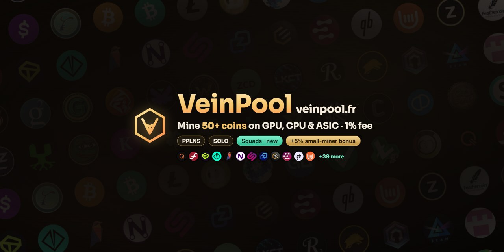
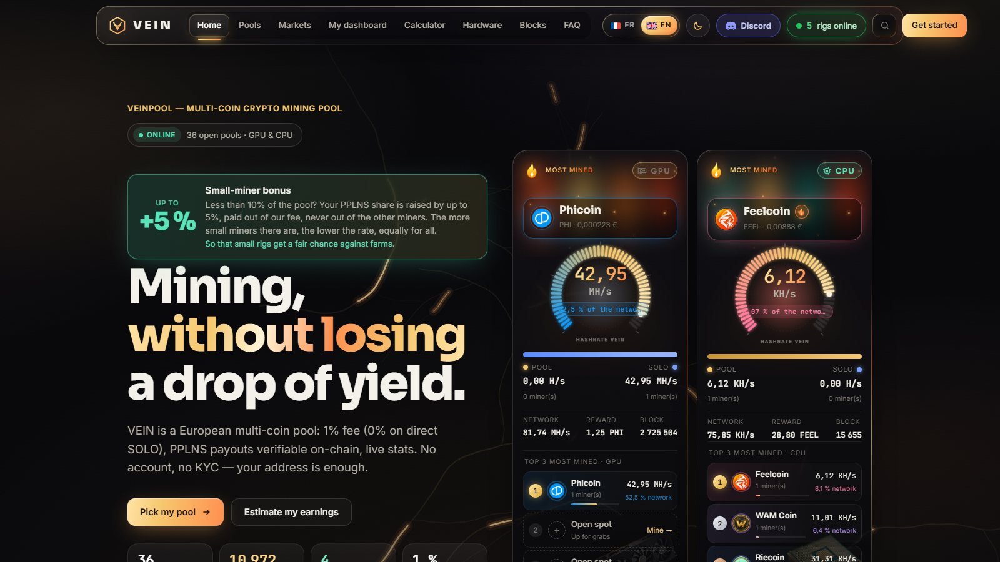
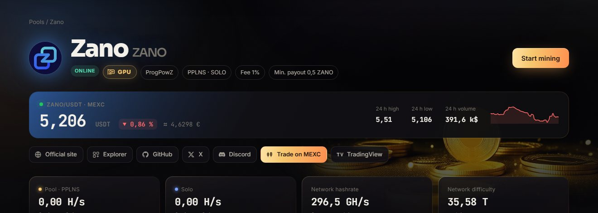
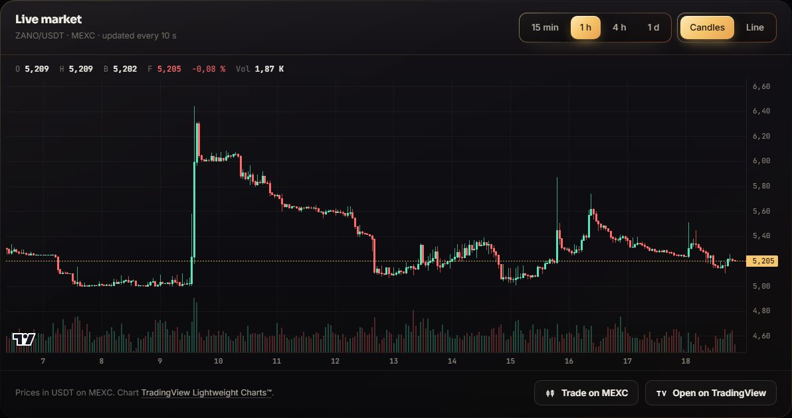
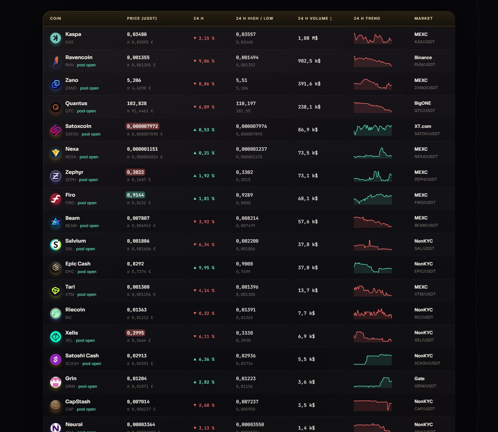
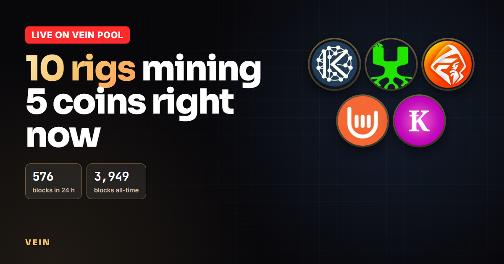
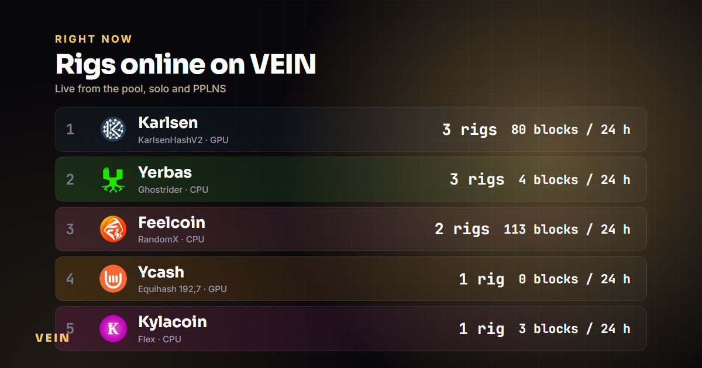
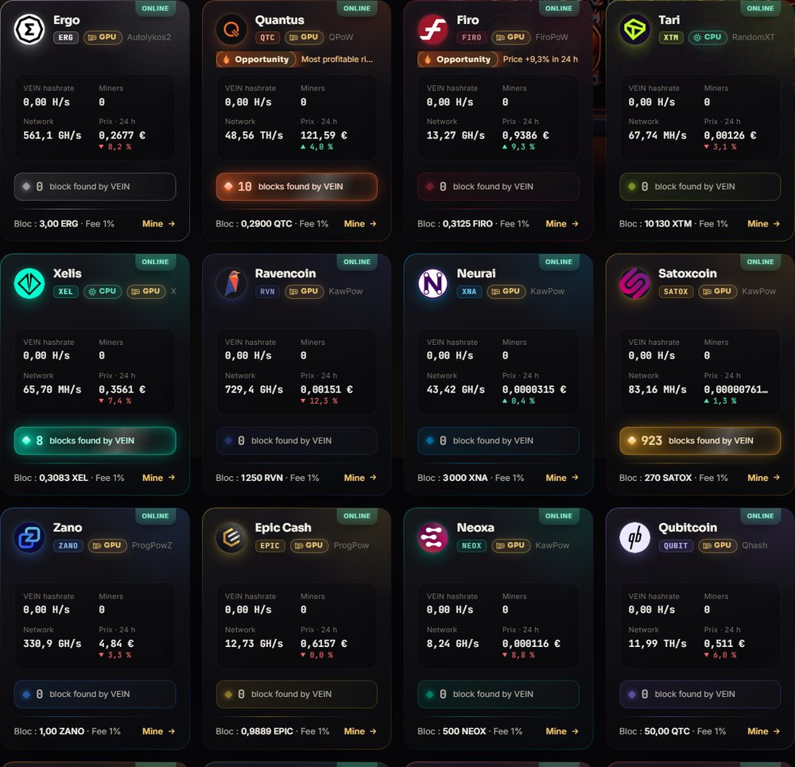
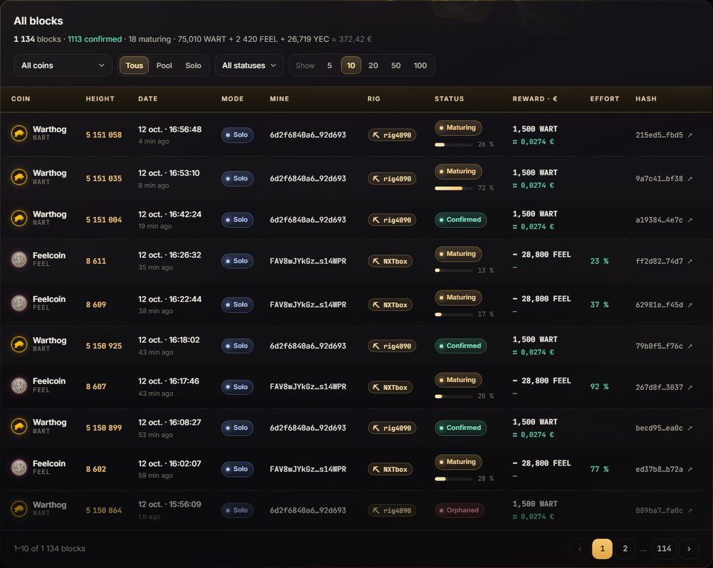

<p align="center">
  <a href="https://veinpool.fr/?lang=en"></a>
</p>

<p align="center">
  <a href="https://veinpool.fr/?lang=en"></a>
  
  
  
  
  
</p>

**VEIN** runs mining pools for small and new proof-of-work coins. Every pool sits on **its own full node** — no proxy, no rented hashrate — and gives you the choice between **PPLNS** (steady payouts, shared by merit) and **SOLO** (the whole block is yours).

<p align="center"><a href="https://veinpool.fr/?lang=en"></a></p>

> ₿ **New — Bitcoin SOLO lottery for NerdMiner, Bitaxe & ASIC.** Our own Bitcoin Core node, ports `3600` (NerdMiner, tiny start difficulty) · `3601` (Bitaxe / NerdAxe) · `3602` (SHA-256 ASIC). Find a block and the whole 3.125 BTC + fees is yours (minus 1 %). Honest odds: a lottery ticket, but a real one. → [veinpool.fr/en/coin/btc](https://veinpool.fr/en/coin/btc) · 🎬 [video](https://youtu.be/1s79oCt-czA)

> 💚 **New — small-miner bonus, up to +5 % on every PPLNS pool.** If your address holds less than 10 % of a block's shares, your share of that block is raised by up to 5 %, **paid out of our 1 % fee — never out of the other miners**. The rate falls fairly as small miners multiply: rate = min(5 %, 1 % ÷ share of the block held by all small miners) → +5 % each while small miners are ≤ 20 % of a block, +2 % at 50 %, +1 % with 100 small miners. Why: so a single GPU or a home CPU gets a real chance next to the farms. [Details](https://veinpool.fr/faq?lang=en#bonus)

- ⚡ **Realtime dashboard** — your rigs appear the second they connect, with alerts when one drops or finds a block
- 🎯 **PPLNS or SOLO** on the same coin, just switch port
- 🪙 **SOLO direct** on Warthog, Dero and Zycord: our node builds the block template **for your own address**, the chain pays you directly — the pool never holds your funds (0 % fee)
- 🧮 **Pool vs solo calculator** and a live hardware ranking (GPUs and CPUs, net of electricity)
- 🔍 Every block the pool finds, with its rig, effort, confirmations and explorer link
- 📈 **New in V3 — live markets**: a TradingView-style candlestick chart on every coin page (15 min → 1 day, refreshed every 10 s from the coin's main exchange) and a live screener of all VEIN coins on the home page

### What's new in V3 (October 2026)

<p align="center"><a href="https://veinpool.fr/coin/zano?lang=en"></a></p>

- **Live price header** on each coin page: last trade, 24 h change, high / low, volume and sparkline, read from the coin's main exchange (MEXC, Binance, Gate, XT.com, BigONE or NonKYC)
- **Official links** for every coin: website, block explorer, GitHub, X, Discord, plus *Trade on …* and *Open on TradingView* where the pair is listed there
- **Candlestick chart** ([TradingView Lightweight Charts™](https://www.tradingview.com/lightweight-charts/), self-hosted, loaded only on coin pages) with volume bars, OHLC legend and 15 min / 1 h / 4 h / 1 day views
- **Live markets screener** on the home page, sortable by price, change or volume, with price flashes on every move
- **3× lighter while idle**: decorative animations rebuilt to run on the GPU compositor only — home page idle CPU down from ~34 % to ~10 % of a core, coin pages from ~10 % to under 1 %
- Coins CoinGecko doesn't list yet (CapStash, LuckyPepe…) now get their euro value from the exchange, so blocks, calculator and cards show what they are worth
- Fewer API calls per visitor (live feed every 8 s instead of 5 s) and a lighter server; all miners stayed connected during the upgrade

Full technical notes: **[CHANGELOG.md](CHANGELOG.md)**

<table>
  <tr>
    <td width="50%"><a href="https://veinpool.fr/coin/zano?lang=en"></a></td>
    <td width="50%"><a href="https://veinpool.fr/?lang=en"></a></td>
  </tr>
  <tr>
    <td align="center"><sub>Live candles from the coin's main exchange, every coin page</sub></td>
    <td align="center"><sub>Every VEIN coin's market, live, on the home page</sub></td>
  </tr>
</table>

### Live right now

<p align="center"><a href="https://veinpool.fr/pools?lang=en"></a> <a href="https://veinpool.fr/blocks?lang=en"></a></p>

**10 rigs · 5 coins · 576 blocks in 24 h · 3,949 blocks all-time** — 🎬 [live recap video](https://youtu.be/G5sRGdY7dUY)

### Coins

| Coin | Algo | Mode | | Coin | Algo | Mode |
|---|---|---|---|---|---|---|
| 🆕 [CapStash](https://veinpool.fr/coin/cap?lang=en) | WhirlpoolX2 (NVIDIA) | PPLNS · SOLO | | 🆕 [Nexa](https://veinpool.fr/coin/nexa?lang=en) | NexaPow | PPLNS · SOLO |
| 🆕 [LuckyPepe](https://veinpool.fr/coin/lpepe?lang=en) | YescryptR32 (CPU) | PPLNS · SOLO | | 🆕 [Kylacoin](https://veinpool.fr/coin/kcn?lang=en) | Flex (CPU) | PPLNS · SOLO |
| 🆕 [Cascoin](https://veinpool.fr/coin/cas?lang=en) | MinotaurX (CPU) | PPLNS · SOLO | | 🆕 [Tidecoin](https://veinpool.fr/coin/tdc?lang=en) | YespowerTIDE (CPU) | PPLNS · SOLO |
| [Quantus](https://veinpool.fr/coin/qtc?lang=en) | QPoW | PPLNS · SOLO | | [Xelis](https://veinpool.fr/coin/xel?lang=en) | XelisHash v3 | PPLNS · SOLO |
| [Firo](https://veinpool.fr/coin/firo?lang=en) | FiroPoW | PPLNS · SOLO | | [Tari](https://veinpool.fr/coin/xtm?lang=en) | RandomXT | PPLNS · SOLO |
| [Ravencoin](https://veinpool.fr/coin/rvn?lang=en) | KawPow | PPLNS · SOLO | | [Qubitcoin](https://veinpool.fr/coin/qubit?lang=en) | Qhash | PPLNS · SOLO |
| [Neurai](https://veinpool.fr/coin/xna?lang=en) | KawPow | PPLNS · SOLO | | [Ycash](https://veinpool.fr/coin/yec?lang=en) | Equihash 192,7 | PPLNS · SOLO |
| [Satoxcoin](https://veinpool.fr/coin/satox?lang=en) | KawPow | PPLNS · SOLO | | [Feelcoin](https://veinpool.fr/coin/feel?lang=en) | RandomX | PPLNS · SOLO |
| [Gaelium](https://veinpool.fr/coin/gael?lang=en) | KawPow | PPLNS · SOLO | | [WAM Coin](https://veinpool.fr/coin/wam?lang=en) | RandomX | PPLNS |
| [Neoxa](https://veinpool.fr/coin/neox?lang=en) | KawPow | PPLNS · SOLO | | [Zycord](https://veinpool.fr/coin/zcd?lang=en) | RandomX v2 | SOLO direct |
| [Kerrigan](https://veinpool.fr/coin/krgneq?lang=en) | Equihash 192,7 | PPLNS · SOLO | | [Epic Cash](https://veinpool.fr/coin/epic?lang=en) | ProgPow | PPLNS · SOLO |
| [Zano](https://veinpool.fr/coin/zano?lang=en) | ProgPowZ | PPLNS · SOLO | | [Dero](https://veinpool.fr/coin/dero?lang=en) | AstroBWTv3 (CPU) | SOLO direct |
| [Warthog](https://veinpool.fr/coin/wart?lang=en) | Janushash (GPU + CPU) | SOLO direct | | [Beam](https://veinpool.fr/coin/beam?lang=en) | BeamHash III | PPLNS · SOLO |
| [Grin](https://veinpool.fr/coin/grin?lang=en) | Cuckatoo32 | PPLNS · SOLO | | 🆕 [Satoshi Cash](https://veinpool.fr/coin/scash?lang=en) | RandomX SCASH (CPU) | PPLNS · SOLO |
| 🆕 [Zephyr](https://veinpool.fr/coin/zeph?lang=en) | RandomX (CPU) | PPLNS · SOLO | | 🆕 [Salvium](https://veinpool.fr/coin/sal?lang=en) | RandomX (CPU) | PPLNS · SOLO |
| 🆕 [Yerbas](https://veinpool.fr/coin/yerb?lang=en) | Ghostrider (CPU) | PPLNS · SOLO | | 🆕 [Karlsen](https://veinpool.fr/coin/kls?lang=en) | KarlsenHashV2 (GPU) | PPLNS · SOLO |
| 🆕 [Riecoin](https://veinpool.fr/coin/ric?lang=en) | Stella primes (CPU) | PPLNS | | 🆕 [Conceal](https://veinpool.fr/coin/ccx?lang=en) | CryptoNight-GPU | PPLNS · SOLO |
| 🆕 [Phicoin](https://veinpool.fr/coin/phi?lang=en) | PhiHash (GPU) | PPLNS · SOLO | | 🆕 [**Bitcoin**](https://veinpool.fr/en/coin/btc) | SHA-256 (ASIC · Bitaxe · NerdMiner) | SOLO lottery |

**Opening next** (nodes syncing, pools configured): Bitcoin Cash (SHA-256, NerdMiner / Bitaxe / ASIC), Litecoin and Dogecoin (Scrypt ASIC), all in SOLO.

<table>
  <tr>
    <td width="50%"><a href="https://veinpool.fr/pools?lang=en"></a></td>
    <td width="50%"><a href="https://veinpool.fr/blocks?lang=en"></a></td>
  </tr>
  <tr>
    <td align="center"><sub>Every coin, with live hashrate and the blocks VEIN found on it</sub></td>
    <td align="center"><sub>Every block: rig, maturity, reward in coins and euros</sub></td>
  </tr>
</table>

### Quick start
```bash
# Warthog SOLO direct (GPU + CPU) — block paid straight to your address
bzminer -a warthog -w YOUR_ADDRESS.rig1 -p stratum+tcp://veinpool.fr:3340 --nvidia --amd --cpu

# Dero SOLO direct (CPU) — use a registered wallet (Engram / dero-wallet-cli)
dero-miner --wallet-address YOUR_ADDRESS --daemon-rpc-address veinpool.fr:3350 --mining-threads 8

# Ravencoin (KawPow) — wallet address = login, no account
t-rex -a kawpow -o stratum+tcp://veinpool.fr:3080 -u YOUR_ADDRESS.rig1 -p x
```
👉 All ports and ready-made commands for Windows, Linux, HiveOS and MMPOS: **[veinpool/mining-configs](https://github.com/veinpool/mining-configs)** · or the wizard on each coin page.

### Open source
- **[miningcore-live-rigs](https://github.com/veinpool/miningcore-live-rigs)** — realtime rig connect/disconnect events for Miningcore pools
- **[mining-configs](https://github.com/veinpool/mining-configs)** — stratum ports and miner commands for every VEIN coin

🌍 **https://veinpool.fr/?lang=en** · en français : **https://veinpool.fr** · 📫 contact@veinpool.fr
